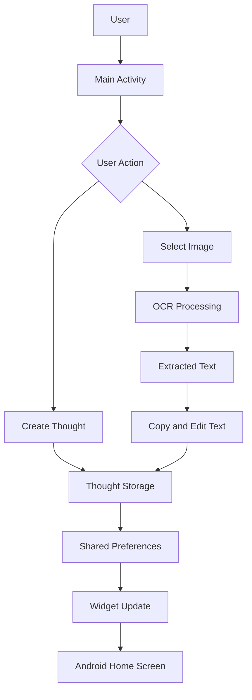
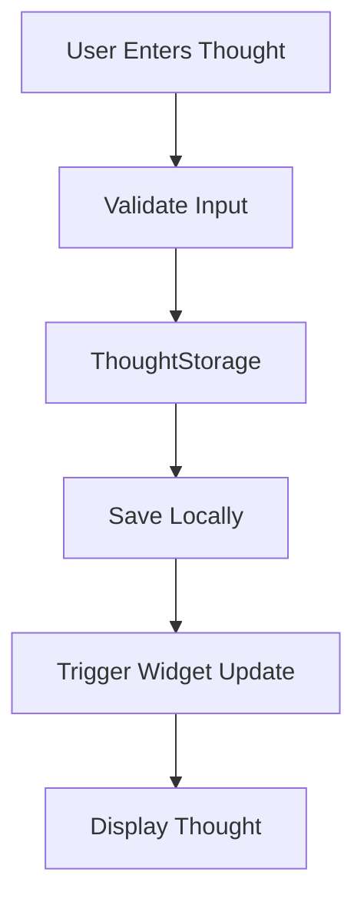
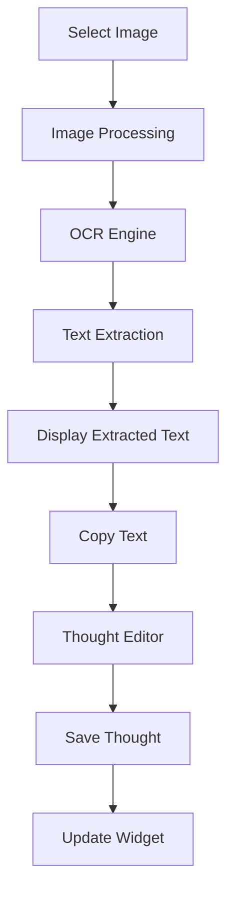

# 💭 ThoughtWidget

**Capture your thoughts. Preserve your ideas. Keep inspiration close.**

ThoughtWidget is an Android application designed to help users capture and display their thoughts directly on their home screen.

Whether it is an inspiring quote, a personal reminder, or an important idea, ThoughtWidget makes it easier to keep meaningful text visible throughout the day.

The application also incorporates OCR functionality, allowing users to extract text from images and reuse it as their thoughts.

## ✨ Features

- 💭 Create and save personal thoughts.
- 🏠 Display thoughts through an Android home screen widget.
- 🖼️ Select images containing text.
- 🔎 Extract text from images using OCR.
- 📋 Copy extracted text.
- ✏️ Edit and reuse extracted text as a thought or hint.
- 💾 Store thought information locally.
- 🎨 Simple and minimal widget interface.

## 🏗️ Architecture

ThoughtWidget follows a modular Android architecture that separates the user interface, storage management, image processing, and widget rendering.

### High-Level Architecture



### Architecture Components

**1. MainActivity**

Handles user interactions and provides the primary interface for creating and managing thoughts.

**2. ThoughtStorage**

Manages local thought persistence using Android SharedPreferences.

Responsibilities include:

- Saving thought content.
- Retrieving saved thoughts.
- Managing stored text.
- Maintaining information required by the widget.

**3. OCR Processing**

Extracts readable text from selected images.

The extracted content can be copied and reused within the thought editor.

**4. Widget Layer**

Uses Android's Glance AppWidget framework to display saved thoughts on the home screen.

## ⚙️ Core Application Logic

### 1. Thought Creation and Storage



The application maintains a single active thought, allowing users to replace or update the currently displayed content.

### 2. OCR Text Extraction



OCR makes it possible to convert text found in images into editable content.

Instead of manually typing a quote or note, users can extract the text and reuse it directly.

### 3. Widget Rendering

The widget retrieves the saved content from local storage and renders it on the Android home screen.

This keeps the widget lightweight and avoids requiring a separate database for a simple thought-storage workflow.

## 📂 Project Structure

```text
ThoughtWidget/
├── app/
│   └── src/
│       └── main/
│           ├── java/com/example/thoughtwidget/
│           │   ├── MainActivity.kt
│           │   ├── ThoughtStorage.kt
│           │   ├── widget/
│           │   │   └── ThoughtWidget.kt
│           │   └── utils/
│           │
│           ├── res/
│           │   ├── drawable/
│           │   ├── values/
│           │   └── xml/
│           │
│           └── AndroidManifest.xml
│
├── build.gradle.kts
├── settings.gradle.kts
└── README.md
```

*Adjust the structure to reflect the actual source files in your repository.*

## 🛠️ Technology Stack

- **Language:** Kotlin
- **UI:** Jetpack Compose
- **Widget Framework:** Jetpack Glance
- **Storage:** Android SharedPreferences
- **Text Recognition:** ML Kit Text Recognition (if used in the current OCR implementation)
- **Image Handling:** Android Image APIs
- **IDE:** Android Studio

## 🚀 Getting Started

### Prerequisites

- Android Studio.
- Android SDK.
- Compatible JDK.
- Git.

### Installation

1. Clone the repository.

```bash
git clone YOUR_REPOSITORY_URL
```

2. Open the project in Android Studio.
3. Sync Gradle dependencies.
4. Build and install the application.
5. Add ThoughtWidget to your Android home screen.
6. Create your first thought.

## 📸 Screenshots

```markdown


```

## 🔮 Future Improvements

- Multiple thought collections.
- Daily thought scheduling.
- More widget customization options.
- Different widget layouts.
- Backup and restore functionality.
- Additional image and text-processing capabilities.

## 🤝 Contributing

Suggestions, improvements, and contributions are welcome.

## 📄 License

Add your chosen open-source license if applicable.
